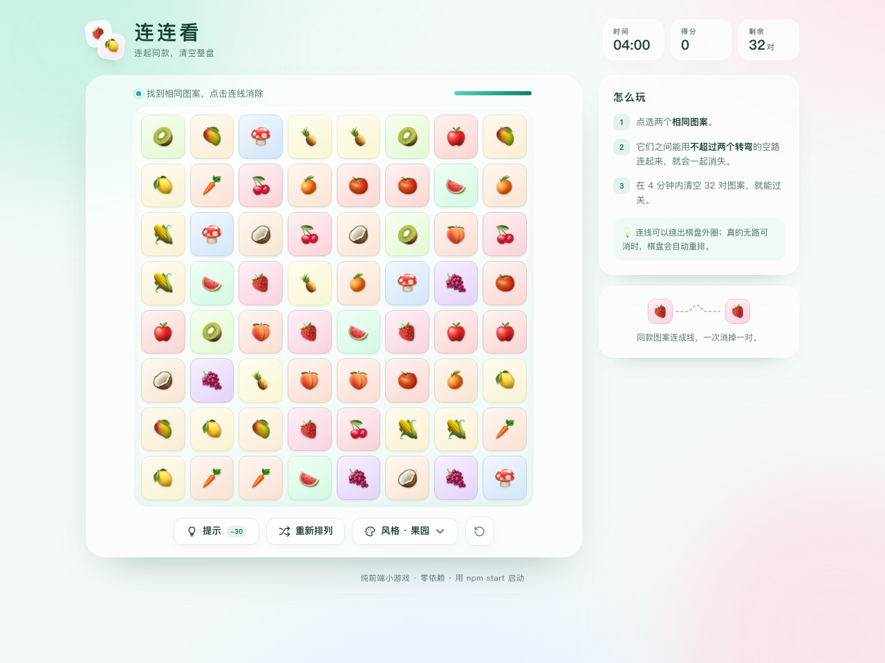
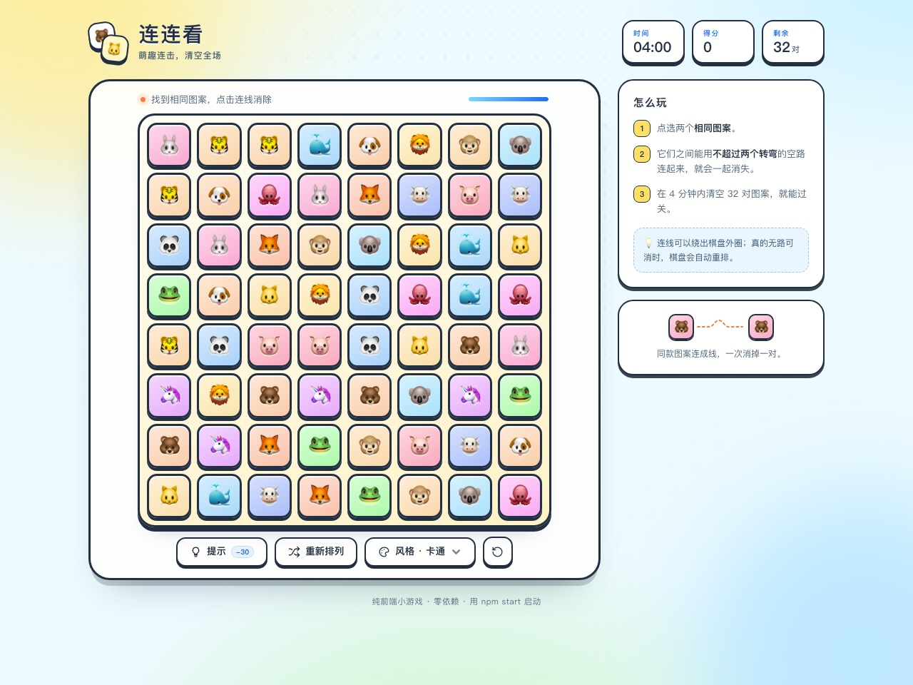
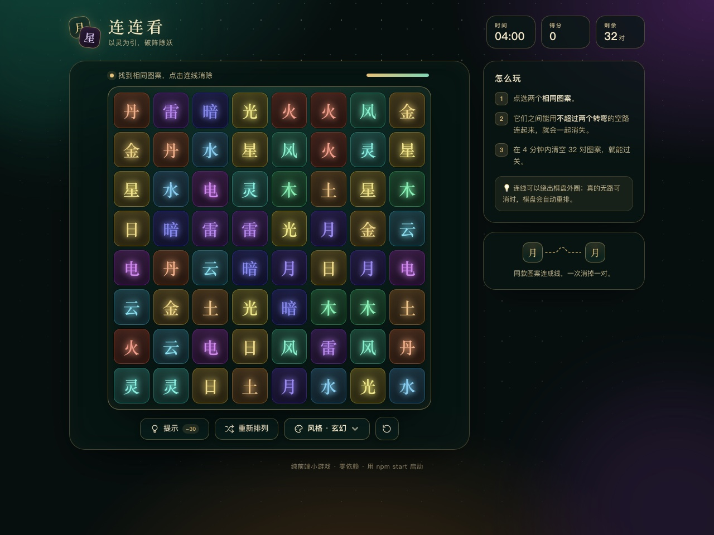
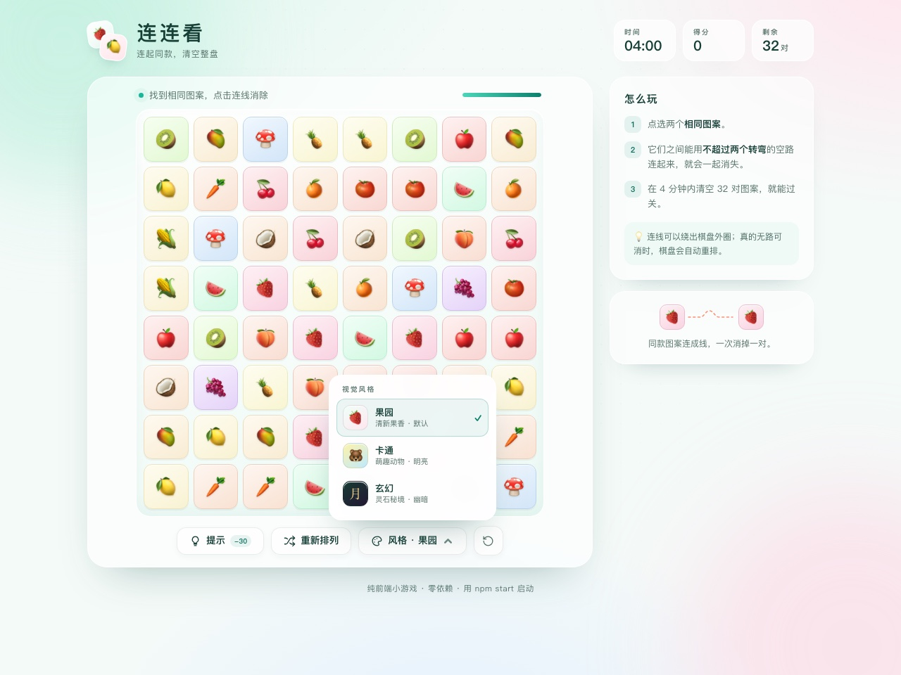

# 连连看 · 网页版

一个零依赖的网页版连连看小游戏，带本地账号登录。登录后点选两个相同图案，只要能用不超过两个转弯的空路连起来，就会一起消除；在 4 分钟内清空整盘 32 对图案即可过关。提供果园、卡通、玄幻三种视觉风格，可随时切换。



## 功能

- 本地账号：注册、登录、退出，未登录时棋盘保持锁定
- 密码使用 scrypt 加盐哈希保存，会话使用 HttpOnly Cookie
- 8 × 8 棋盘，16 种图案，经典两转弯连线规则
- 三种视觉风格：果园（水果）、卡通（动物）、玄幻（灵纹）
- 风格选择会保存在浏览器本地，下次打开仍然生效
- 连线可以绕出棋盘外圈，符合经典连连看玩法
- 提示（扣 30 分）、手动重排、无路可消时自动重排
- 4 分钟倒计时、得分与剩余时间奖励、过关 / 超时结算
- 响应式布局，支持桌面和手机浏览器
- 纯 HTML / CSS / JavaScript 与 Node.js 内置模块，无框架、无构建步骤、无第三方依赖

## 账号与登录

首次打开页面时点击「注册」创建账号，之后用同一账号登录即可开始游戏。用户名支持 2–20 个字符（中英文、数字、下划线、短横线），密码为 8–128 个字符。


- 账号保存在运行服务的电脑上（默认 `.data/users.json`，可用 `AUTH_DATA_DIR` 修改），密码只保存 scrypt 哈希，不保存明文。
- 登录会话保存在内存中，有效期 7 天；重启服务后需要重新登录。
- 删除 `.data/` 目录即可清空本机全部账号。
- 当前实现面向本机试玩，不是生产级身份系统：没有邮箱验证、找回密码、多设备会话管理。部署到公网前应改用 HTTPS、正式数据库和更强的登录保护。

## 视觉风格

点击棋盘下方的“风格”按钮，可在三种风格之间切换；切换不会重置棋盘，当前选择和倒计时都会保留。

| 卡通 | 玄幻 |
| --- | --- |
|  |  |



## 本地运行

需要 Node.js 20 或更高版本。

```bash
npm start
```

然后打开 <http://127.0.0.1:4173>。账号登录由 `npm start` 启动的本地服务提供；如果改用 `python3 -m http.server` 等纯静态服务器，页面可以打开，但会提示“无法连接登录服务”，无法登录。

可选环境变量：

| 变量 | 默认值 | 说明 |
| --- | --- | --- |
| `PORT` | `4173` | 监听端口 |
| `HOST` | `127.0.0.1` | 监听地址 |
| `AUTH_DATA_DIR` | `./.data` | 账号数据目录 |

## 测试

```bash
npm test
```

测试覆盖棋盘生成、两转弯路径判定、绕外圈连线、提示与重排、计时与结算，以及账号校验、密码哈希、会话与登录接口。

## 项目结构

```text
index.html             页面结构
assets/styles.css      基础样式与响应式布局
assets/themes.css      果园 / 卡通 / 玄幻三套主题
assets/favicon.svg     站点图标
src/game.js            纯游戏逻辑（棋盘、路径判定、状态机）
src/themes.js          视觉主题与图案配置
src/app.js             DOM 渲染、交互、主题切换、计时与动画
src/auth.js            登录 / 注册 / 退出与当前用户请求
server/auth.mjs        账号校验、密码哈希、用户与会话存储
server/app.mjs         静态文件与登录接口的 HTTP 服务
scripts/serve.mjs      本地启动入口
tests/game.test.js     游戏逻辑与主题配置单元测试
tests/auth.test.js     账号逻辑、接口与静态资源访问测试
docs/screenshots/      界面截图
```

## 玩法说明

1. 登录账号，点击“开始游戏”。
2. 点选两个相同图案。
3. 两个图案之间的空路最多允许两个转弯；路径可以绕到棋盘外圈。
4. 可以消除时，连线会画出并一起消失。
5. 清空全部图案即过关；倒计时结束则本局失败。

提示会从当前得分中扣除至多 30 分，重排不扣分。
